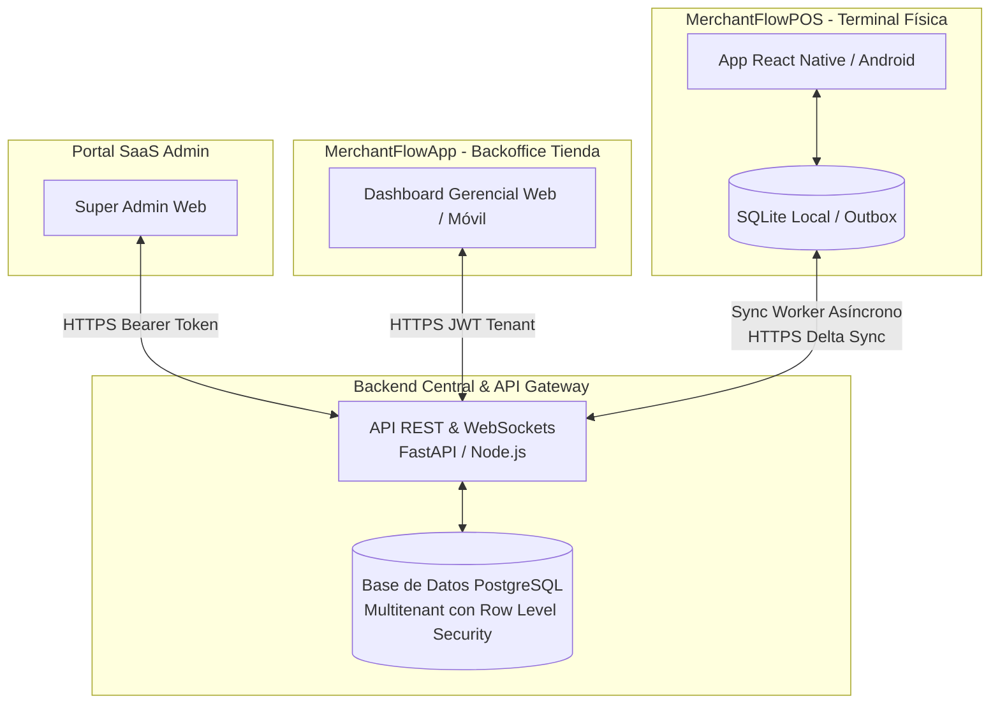

# MerchantApp 🚀

**MerchantApp** es un ecosistema integral de Punto de Venta (POS) y gestión comercial modular y adaptable, desarrollado con **React Native** para despliegue multiplataforma (Android nativo y Web en línea).

---

## 🏗️ Arquitectura y Separación de Proyectos

Para optimizar los pipelines de **CI/CD independientes**, despliegues aislados y mantenimiento sin acoplamiento, las aplicaciones están separadas en proyectos frontend independientes:

```text
MerchantFlow/
├── apps/
│   ├── MerchantFlowPOS/   # Terminal POS táctil (Android / Web) - ✅ Versión activa
│   └── MerchantFlowApp/   # Aplicación de gestión y Backoffice operativo
├── .github/workflows/
│   ├── merchantflow-pos.yml # CI/CD automatizado independiente para POS
│   └── merchantflow-app.yml # CI/CD automatizado independiente para App de Gestión
├── docs/
│   ├── DATABASE_DESIGN_SAAS_BACKOFFICE.md # Diseño multitenant SaaS & Backoffice
│   ├── DATA_PERSISTENCE_STRATEGY.md       # Arquitectura Offline-First y Local DB
│   └── schema.sql                         # Script DDL relacional para PostgreSQL
└── README.md
```

---

## 🗄️ Funcionamiento de la Base de Datos para Ambos Proyectos

El ecosistema opera bajo un modelo híbrido **Cloud Central (PostgreSQL) + Local Offline-First (SQLite en Terminal)**:



### 1. `MerchantFlowApp` (Backoffice de Tienda y SaaS Admin)
- **Conexión Directa a la Nube:** Opera conectado a la API central en tiempo real.
- **SaaS Admin:** Aprovisiona tiendas (`tenants`), controla el límite de terminales contratadas (`pos_terminals.allowed_terminals_count`) y monitorea dispositivos vinculados (`device_bindings`).
- **Backoffice Tienda:**
  - Gestiona catálogo (`products`, `categories`), promociones (`discounts`) y personalización (`store_settings`).
  - **Régimen de Impuestos Personalizable:** Permite configurar si la tienda opera bajo **Público en General** (precios netos sin desglose de IVA) o con **Desglose de Impuestos** (`tax_scheme = 'ITEMIZED_TAX'`), reflejándose en tickets impresos y reportes.
  - Administra usuarios y define el **PIN numérico de 4 a 6 dígitos** (`cashier_pin`) para cada cajero.
  - Monitorea en vivo el **Dashboard de Cortes de Caja** (`cash_cuts`), ventas por hora y arqueos de turnos (`shifts`).

### 2. `MerchantFlowPOS` (Terminal de Punto de Venta)
- **Operación Local Ininterrumpida:** La terminal almacena en SQLite local el catálogo de productos y valida los PINs de los cajeros en milisegundos sin requerir conexión a internet activa.
- **Alternancia de Formas de Pago Mixtas:** Permite registrar múltiples abonos por venta (`transaction_payments`), combinando efectivo, tarjetas y transferencias hasta cubrir el saldo.
- **Sincronización Outbox:** Cada venta se guarda localmente con estado `PENDING_SYNC` y un worker en segundo plano sincroniza las transacciones con el backend central tan pronto detecta red.

---

## 🌐 Diseño del API (Endpoints Principales)

La API sigue un estándar RESTful con autenticación JWT y encabezado de identificación de terminal:

### 1. Módulo SaaS Admin
- `POST /api/v1/saas/tenants`: Registra una nueva tienda con su cuenta maestra y número de cajas autorizadas.
- `GET /api/v1/saas/tenants/{tenant_id}/terminals`: Lista las cajas contratadas y códigos de vinculación.
- `POST /api/v1/saas/terminals/{terminal_id}/revoke`: Revoca la licencia de un dispositivo vinculado.

### 2. Módulo de Enrolamiento de Hardware & Dispositivos (POS)
- `POST /api/v1/pos/enroll`:
  - **Payload:** `{ enrollment_key, device_uuid, device_model, os_version, app_version }`
  - **Respuesta:** Token de terminal firmado (`terminal_token`) y configuración de la tienda.

### 3. Módulo de Backoffice Tienda (Gestión y Personalización)
- `POST /api/v1/tenant/auth/login`: Autenticación del administrador de tienda (devuelve JWT con `tenant_id` y `role`).
- `GET / PUT /api/v1/tenant/settings`: Lee y actualiza la personalización del ticket, logo y esquema tributario (`tax_scheme: 'GENERAL_PUBLIC' | 'ITEMIZED_TAX'`).
- `CRUD /api/v1/tenant/products`: Administración de productos, códigos de barras, precios y costos.
- `CRUD /api/v1/tenant/users`: Alta y baja de cajeros y actualización de su `cashier_pin`.
- `GET /api/v1/tenant/dashboard/cash-cuts`: Historial y resumen analítico de cortes de caja (X y Z).

### 4. Módulo de Sincronización POS (Sync Protocol)
- `GET /api/v1/pos/sync/pull?last_pulled_at=TIMESTAMP`: Descarga incremental de productos, precios, descuentos y cajeros activos.
- `POST /api/v1/pos/sync/push`: Subida por lotes de transacciones finalizadas y turnos cerrados:
  ```json
  {
    "shifts": [
      {
        "id": "uuid-shift-1",
        "cashier_user_id": "uuid-user-3",
        "opening_cash": 500.00,
        "counted_cash": 1850.00,
        "opened_at": "2026-10-28T08:00:00Z",
        "closed_at": "2026-10-28T16:00:00Z"
      }
    ],
    "transactions": [
      {
        "id": "uuid-trans-101",
        "shift_id": "uuid-shift-1",
        "folio": "FOL-10023",
        "subtotal": 450.00,
        "is_tax_itemized": false,
        "taxes_total": 0.00,
        "total": 450.00,
        "total_received": 500.00,
        "change_given": 50.00,
        "payments": [
          { "method": "TARJETA_DEBITO", "amount_tendered": 250.00, "amount_applied": 250.00 },
          { "method": "EFECTIVO", "amount_tendered": 250.00, "amount_applied": 200.00, "change_amount": 50.00 }
        ]
      }
    ]
  }
  ```

---

## 🏃 Instrucciones para Ejecutar `MerchantFlowPOS`

### Prerrequisitos
- Node.js (v18+)
- npm o yarn

### Pasos
1. Entrar en la carpeta de la terminal:
   ```bash
   cd apps/MerchantFlowPOS
   ```
2. Ejecutar en versión Web:
   ```bash
   npm run web
   ```
3. Ejecutar en Android:
   ```bash
   npm run android
   ```
