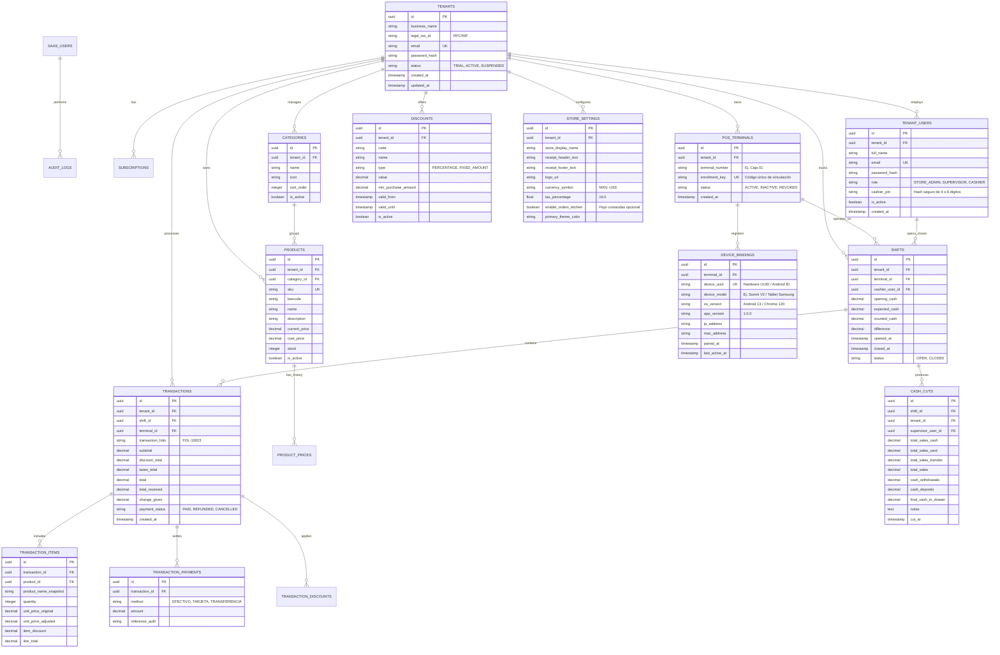

# Diseño de Base de Datos Multitenant: SaaS Admin & Backoffice

Este documento describe la arquitectura de base de datos relacional (PostgreSQL) para el ecosistema **MerchantApp**, estructurada en dos niveles administrativos principales:
1. **SaaS Admin:** Control maestro de suscripciones, licenciamiento de terminales (cajas) por tienda y enrolamiento de hardware.
2. **Backoffice Tienda (Tenant):** Administración operativa del negocio (catálogo, precios, descuentos, personalización de tickets, dashboard de cortes de caja, transacciones y control de cajeros con PIN).

---

## 🏛️ Diagrama Entidad-Relación (ERD)



---

## 🔐 1. Nivel SaaS Admin (Super Administrador de la Plataforma)

Permite aprovisionar tiendas y gobernar las licencias de terminales y su correlación con los dispositivos físicos.

### 1.1 `tenants` (Tiendas / Clientes Contratantes)
| Columna | Tipo | Restricciones | Descripción |
|---|---|---|---|
| `id` | UUID | PK, default `gen_random_uuid()` | Identificador universal de la tienda. |
| `business_name` | VARCHAR(150) | NOT NULL | Razón comercial (ej. "Cafetería El Faro"). |
| `legal_tax_id` | VARCHAR(30) | NULL | Identificador fiscal (RFC, NIF, RUT). |
| `email` | VARCHAR(150) | UNIQUE, NOT NULL | Cuenta principal única de la tienda. |
| `password_hash` | VARCHAR(255) | NOT NULL | Hash (Argon2id o BCrypt) para login de administración. |
| `allowed_terminals_count` | INT | NOT NULL, DEFAULT 1 | **Número de cajas contratadas**. |
| `status` | VARCHAR(20) | NOT NULL, DEFAULT 'ACTIVE' | `TRIAL`, `ACTIVE`, `SUSPENDED`, `CANCELLED`. |
| `created_at` | TIMESTAMPTZ | DEFAULT NOW() | Fecha de alta en el SaaS. |
| `updated_at` | TIMESTAMPTZ | DEFAULT NOW() | Última actualización. |

### 1.2 `pos_terminals` (Licencias de Caja / Terminales)
Garantiza que una tienda no exceda el número de cajas contratadas y emite un código de enrolamiento único.
| Columna | Tipo | Restricciones | Descripción |
|---|---|---|---|
| `id` | UUID | PK, default `gen_random_uuid()` | Identificador universal de la terminal POS. |
| `tenant_id` | UUID | FK `tenants(id)`, NOT NULL | Tienda a la que pertenece la caja. |
| `terminal_number` | VARCHAR(50) | NOT NULL | Identificador legible (ej. "Caja 01 - Mostrador"). |
| `enrollment_key` | VARCHAR(64) | UNIQUE, NOT NULL | **Token o ID único de activación** ingresado en el dispositivo. |
| `status` | VARCHAR(20) | DEFAULT 'ACTIVE' | `ACTIVE`, `INACTIVE`, `REVOKED`. |
| `created_at` | TIMESTAMPTZ | DEFAULT NOW() | Fecha de creación de la caja. |

### 1.3 `device_bindings` (Correlación con el Dispositivo Físico)
Asocia la terminal POS autorizada con la huella digital y metadatos del hardware físico.
| Columna | Tipo | Restricciones | Descripción |
|---|---|---|---|
| `id` | UUID | PK, default `gen_random_uuid()` | Identificador del vínculo. |
| `terminal_id` | UUID | FK `pos_terminals(id)`, NOT NULL | Terminal autorizada asociada. |
| `device_uuid` | VARCHAR(100) | NOT NULL | **Identificador de hardware único** (Android ID / Hardware Serial / Browser fingerprint). |
| `device_model` | VARCHAR(100) | NULL | Modelo (ej. "Sunmi V2 PRO", "Samsung Tab S8", "Chrome Desktop"). |
| `os_version` | VARCHAR(50) | NULL | Versión del SO (ej. "Android 13"). |
| `app_version` | VARCHAR(30) | NOT NULL | Versión de la app cliente (`1.0.0`). |
| `ip_address` | INET | NULL | Última dirección IP registrada. |
| `mac_address` | VARCHAR(50) | NULL | Dirección física de red (si está disponible). |
| `paired_at` | TIMESTAMPTZ | DEFAULT NOW() | Momento de activación del dispositivo. |
| `last_active_at` | TIMESTAMPTZ | DEFAULT NOW() | Último ping/heartbeat de actividad. |

---

## 🏢 2. Nivel Backoffice Tienda (Portal Administrativo)

Permite al dueño o gerente de tienda gestionar su operativa diaria, catálogo, personal y reportes financieros.

### 2.1 `tenant_users` (Usuarios y Cajeros de la Tienda)
| Columna | Tipo | Restricciones | Descripción |
|---|---|---|---|
| `id` | UUID | PK | Identificador del usuario. |
| `tenant_id` | UUID | FK `tenants(id)`, NOT NULL | Tienda a la que pertenece. |
| `full_name` | VARCHAR(120) | NOT NULL | Nombre y apellidos del colaborador. |
| `email` | VARCHAR(150) | NULL | Correo para acceso al Backoffice web (opcional para cajeros puros). |
| `password_hash` | VARCHAR(255) | NULL | Clave de acceso al Backoffice web. |
| `role` | VARCHAR(20) | NOT NULL | `STORE_ADMIN`, `SUPERVISOR`, `CASHIER`. |
| `cashier_pin` | VARCHAR(255) | NULL | **Hash seguro del PIN de 4 o 6 dígitos** para arrancar o cambiar turno en la caja física. |
| `is_active` | BOOLEAN | DEFAULT TRUE | Estado del empleado. |

### 2.2 `store_settings` (Personalización de la Tienda)
| Columna | Tipo | Restricciones | Descripción |
|---|---|---|---|
| `id` | UUID | PK | Identificador de configuración. |
| `tenant_id` | UUID | FK `tenants(id)`, UNIQUE | Tienda configurada. |
| `receipt_header_text`| TEXT | NULL | Texto superior del ticket térmico (dirección, teléfono, wifi). |
| `receipt_footer_text`| TEXT | NULL | Leyenda al pie del ticket ("¡Gracias por su compra!"). |
| `logo_url` | TEXT | NULL | Logotipo para impresión de ticket o pantalla de cobro. |
| `currency_symbol` | VARCHAR(10) | DEFAULT 'MXN' | Símbolo o divisa de cobro. |
| `tax_percentage` | DECIMAL(5,2)| DEFAULT 16.00 | Porcentaje de impuestos (IVA, etc.). |
| `enable_orders_kitchen` | BOOLEAN | DEFAULT FALSE | Activa o desactiva el flujo de comandas. |

### 2.3 `products` y `categories` (Catálogo y Precios)
- **`categories`:** `id`, `tenant_id`, `name`, `icon`, `sort_order`, `is_active`.
- **`products`:** `id`, `tenant_id`, `category_id`, `sku`, `barcode`, `name`, `description`, `current_price`, `cost_price`, `stock`, `is_active`.
- **`discounts`:** `id`, `tenant_id`, `code`, `name`, `type` (`PERCENTAGE`, `FIXED_AMOUNT`), `value`, `min_purchase_amount`, `valid_from`, `valid_until`, `is_active`.

---

## 📊 3. Turnos, Cortes de Caja y Auditoría de Ventas

### 3.1 `shifts` (Aperturas y Cierres de Turno)
Registra la vida del turno en cada terminal física con el cajero autenticado mediante su PIN.
- `id`: UUID (PK).
- `tenant_id`: UUID (FK).
- `terminal_id`: UUID (FK).
- `cashier_user_id`: UUID (FK).
- `opening_cash`: DECIMAL(12,2) (Fondo inicial de caja).
- `expected_cash`: DECIMAL(12,2) (Calculado por sistema).
- `counted_cash`: DECIMAL(12,2) (Efectivo físico declarado por el cajero al cerrar).
- `difference`: DECIMAL(12,2) (Sobrante o faltante).
- `opened_at` / `closed_at`: TIMESTAMPTZ.
- `status`: `OPEN`, `CLOSED`.

### 3.2 `cash_cuts` (Cortes de Caja X y Z para el Dashboard)
Consolidación para reportería en el Backoffice:
- Total ventas en efectivo, tarjeta y transferencia.
- Total de retiros parciales de caja (gastos menores) o ingresos extra.
- Comparativa entre venta real y ventas calculadas.

### 3.3 `transactions` y `transaction_items`
- Registro atómico de cada ticket con desglose de ítems, precio original vs precio modificado en venta, descuentos aplicados, desglose de métodos de pago (`transaction_payments`), cantidad recibida y cambio entregado.

---

## 🛡️ Aislamiento Multitenant (Row-Level Security - RLS)

En PostgreSQL, todas las tablas contienen `tenant_id`. Se habilitará **Row-Level Security** para garantizar que ningún cliente pueda consultar o mutar datos de otra tienda:

```sql
ALTER TABLE products ENABLE ROW LEVEL SECURITY;

CREATE POLICY tenant_isolation_policy ON products
  FOR ALL
  USING (tenant_id = current_setting('app.current_tenant_id')::uuid);
```
