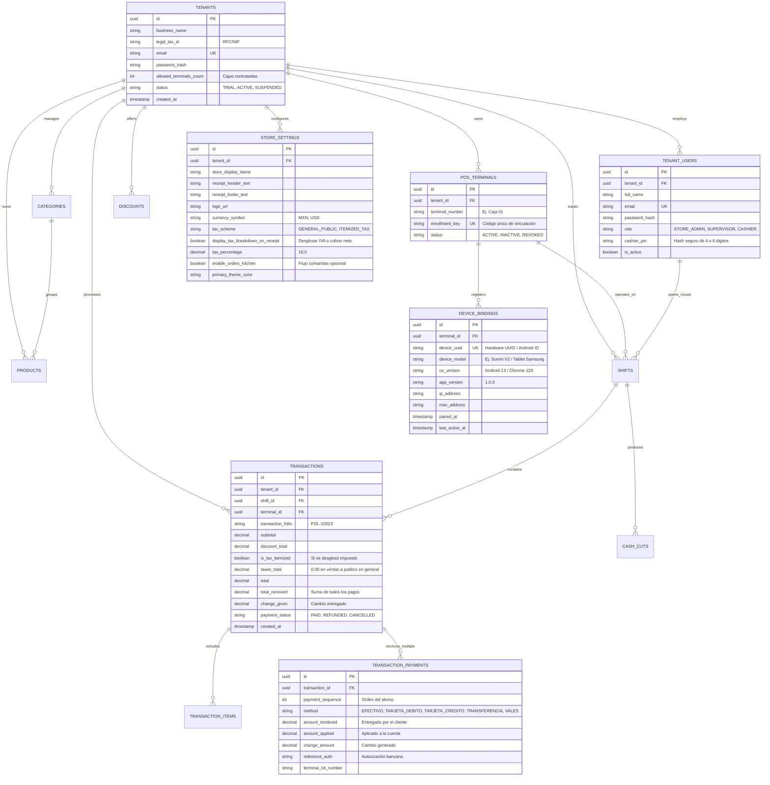

# Diseño de Base de Datos Multitenant: SaaS Admin & Backoffice

Este documento describe la arquitectura de base de datos relacional (PostgreSQL) para el ecosistema **MerchantApp**, estructurada en dos niveles administrativos principales:
1. **SaaS Admin:** Control maestro de suscripciones, licenciamiento de terminales (cajas) por tienda y enrolamiento de hardware.
2. **Backoffice Tienda (Tenant):** Administración operativa del negocio (catálogo, precios, descuentos, personalización de tickets y esquema de impuestos, dashboard de cortes de caja, transacciones y control de cajeros con PIN).

---

## 🏛️ Diagrama Entidad-Relación (ERD)



---

## 💳 1. Alternancia de Múltiples Formas de Pago en una Transacción (Pagos Mixtos)

En operaciones reales de punto de venta, un cliente puede pagar una cuenta combinando diferentes métodos (ejemplo: cuenta total de \$1,000 MXN pagada con \$400 en Efectivo y \$600 con Tarjeta de Débito, o con \$800 en Transferencia y \$500 en Efectivo recibiendo \$300 de cambio).

### Tabla `transaction_payments`
Cada transacción en `transactions` puede contener uno o más registros en `transaction_payments`:
- `id`: UUID (PK).
- `transaction_id`: UUID (FK a `transactions`).
- `payment_sequence`: Entero secuencial que indica el orden en el que se fueron recibiendo los abonos (1, 2, 3...).
- `method`: Tipo de forma de pago (`EFECTIVO`, `TARJETA_DEBITO`, `TARJETA_CREDITO`, `TRANSFERENCIA`, `VALES`, `OTRO`).
- `amount_tendered`: Cantidad entregada o procesada por el cliente para este método.
- `amount_applied`: Cantidad efectiva que cubre el saldo de la venta.
- `change_amount`: Si el método es `EFECTIVO` y `amount_tendered > amount_applied`, se almacena aquí el cambio/vuelto originado por este pago.
- `reference_auth`: Folio de autorización o voucher bancario devuelto por la pasarela/terminal de tarjeta.

**Regla de Integridad:**
$$\sum \text{amount\_applied} = \text{transactions.total}$$
$$\sum \text{amount\_tendered} = \text{transactions.total\_received}$$
$$\sum \text{change\_amount} = \text{transactions.change\_given}$$

---

## 🧾 2. Esquema de Impuestos Personalizable: Público General vs Desglose Tributario

Muchos comercios (cafeterías, abarrotes, fondas, tiendas de conveniencia) comercializan productos con **precio final neto** y emiten comprobantes simplificados a **Público en General**, consolidando una factura global al final del día/mes sin calcular ni desglosar IVA en cada ticket individual. Otros comercios sí requieren desglosar subtotal e IVA por venta.

### En `store_settings`:
- **`tax_scheme`:**
  - `'GENERAL_PUBLIC'` *(Predeterminado)*: Las ventas se registran y cobran a precio neto cerrado.
  - `'ITEMIZED_TAX'`: El sistema calcula y segrega el subtotal base y el porcentaje de impuesto.
- **`display_tax_breakdown_on_receipt` (Boolean):**
  - Si es `false`: En la pantalla del POS y en el ticket térmico impreso solo se imprime:
    ```text
    Subtotal:           $150.00
    Descuento:           -$0.00
    TOTAL A PAGAR:      $150.00
    (Venta a Público en General)
    ```
  - Si es `true`: Se imprime el desglose formal:
    ```text
    Subtotal:           $129.31
    IVA (16%):           $20.69
    TOTAL A PAGAR:      $150.00
    ```

### En `transactions`:
- `is_tax_itemized`: Booleano guardado como snapshot histórico de si esa venta particular mostró o desglosó impuestos.
- `taxes_total`: Monto de impuesto calculado (`0.00` cuando la tienda opera en régimen simplificado / público en general).
